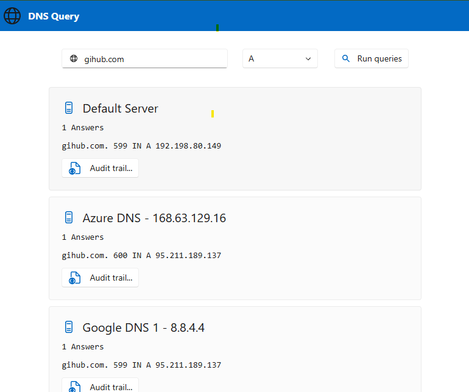

# DNS Lookup tool
DNS Lookup Diagnostic tool embedded in a container



## Description
This tool is a web application that allows executing DNS queries inside a container to test DNS resolution as a client workload.

## Local development with Aspire

The solution now includes an Aspire AppHost that orchestrates the DNS Lookup app and forwards telemetry.

Run locally from the repository root:

```powershell
dotnet restore .\src\mpelabs.dnslookup.sln
dotnet run --project .\src\mpelabs.dnslookup.AppHost
```

## OpenTelemetry logs

The web app uses Aspire ServiceDefaults and exports OpenTelemetry data when an OTLP endpoint is configured.

- With Aspire AppHost, the endpoint is configured automatically for local runs.
- Outside Aspire, define `OTEL_EXPORTER_OTLP_ENDPOINT` (example: `http://localhost:4317`).

## Configuration

### How to install

The application is distributed as a container image. To run the application, you need to have Docker installed on your system or use a container runtime that supports Docker images.
the image is available on Docker Hub here: https://hub.docker.com/r/miiitch/mpelabs.dnslookup.

### Image configuration

The application in a .net blazor app. you can configure the server to run on a specific port by setting the environment variable `ASPNETCORE_HTTP_PORTS` to the desired port.

The documentation is here: https://learn.microsoft.com/en-us/dotnet/core/containers/publish-configuration#containerport

### DNS Servers

By default, no DNS Servers are configured. You must set a list of server either:
* from the environment variable `DNS_SERVERS`. The list must be separated by `;`.
* from the query string `server` in the URL. You can add multiple server statements in the query string.

A server is either a preconfigured set of servers or a custom server. The pre-configured servers are:
- `google`: `8.8.8.8` & `8.8.4.4`
- `cloudflare`: `1.1.1.1` & `1.0.0.1`
- `opendns`: `208.67.222.222` & `208.67.220.220` (may not work in some countries)
- `azure`: `168.63.129.16`, the default internal DNS server of Azure
- `default`: the default DNS server of the host

Custom servers are defined by the name and IP address of the server:
- `MYSERVER=1.2.4.4`

Example of configuration:
```
DNS_SERVERS=google;MYSERVER=4.2.5.5
```

### Query timeout and retries

You can configure the DNS query timeout and number of retries either via environment variables or URL query parameters. URL parameters take priority over environment variables.

| Parameter | Environment variable | URL query parameter | Default |
|-----------|---------------------|---------------------|---------|
| Timeout   | `DNS_TIMEOUT_MS`    | `timeout`           | `2000` ms |
| Retries   | `DNS_RETRIES`       | `retries`           | `1`     |

> The timeout applies **per attempt**. With `retries=1`, the maximum wait per server is `timeout × (1 + retries)` = 4 000 ms by default.

Example — set timeout to 500 ms and 0 retries via environment variables:
```
DNS_TIMEOUT_MS=500
DNS_RETRIES=0
```

Example — override per request via URL:
```
https://your-tool/?server=google&server=cloudflare&timeout=3000&retries=2
```

### Query behaviour

Queries to all configured DNS servers are executed **in parallel**. Each server card updates independently as soon as its response arrives (or times out), so you can see results progressively without waiting for the slowest server.

### Customization

You can add a supplemental title to the page by setting the environment variable `CUSTOMIZATION_PAGE_TITLE` to the desired title. The default title is "DNS Lookup".


